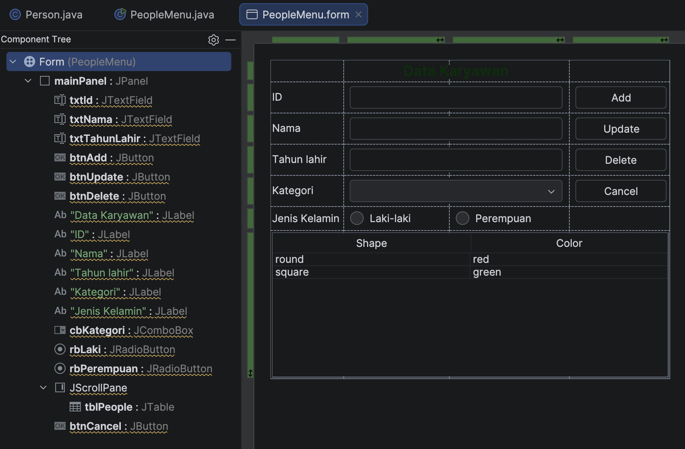
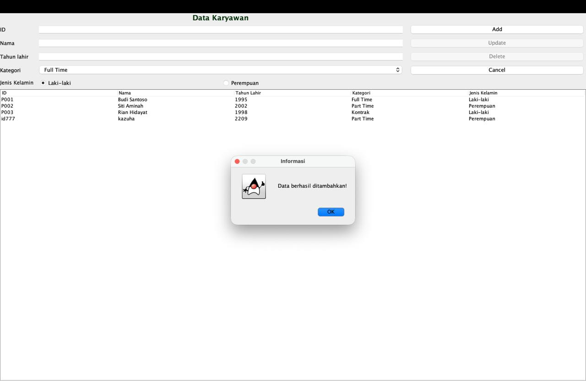
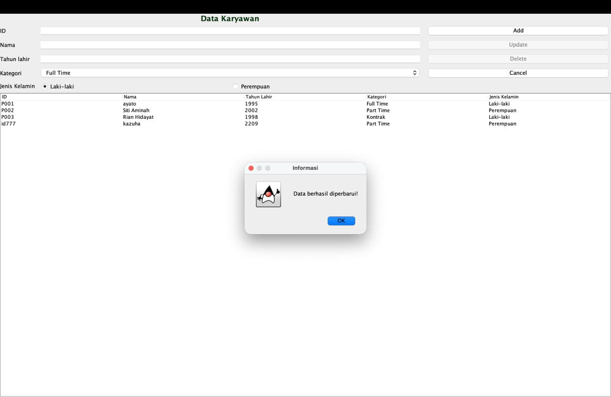
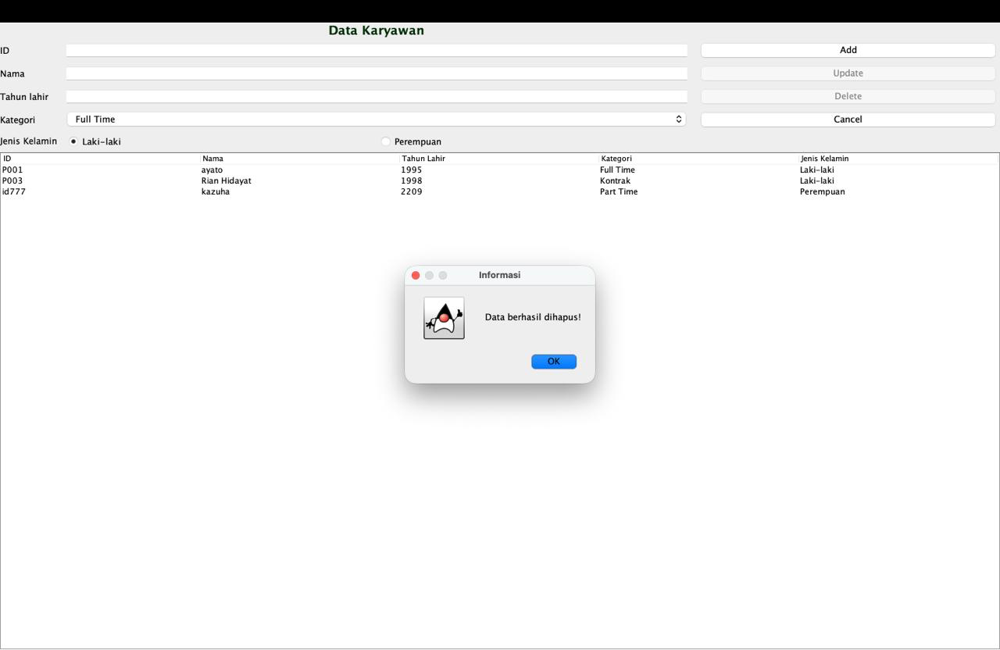
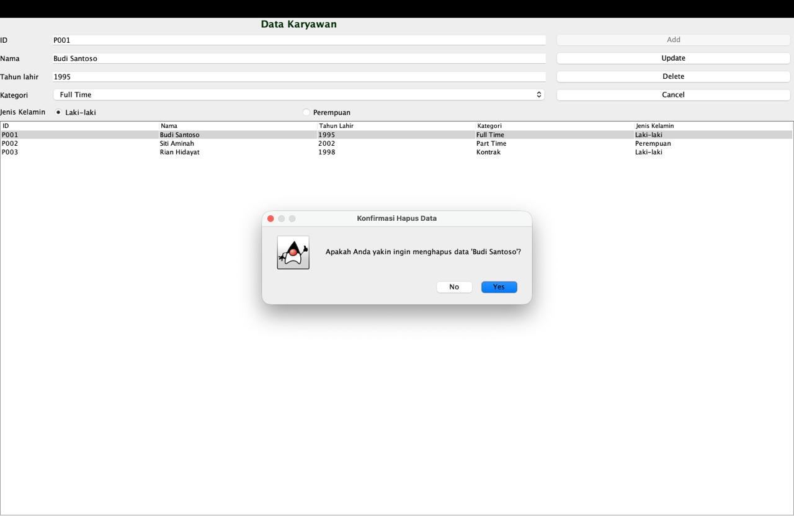

# JANJI
Saya Muhammad Dzaka Indrianto dengan NIM 2508755 mengerjakan Tugas Praktikum 4 dalam mata kuliah Desain dan Pemrograman Berorientasi Objek untuk keberkahanNya maka saya tidak melakukan kecurangan seperti yang telah dispesifikasikan. Aamiin.

# Desain

## Penjelasan
alasan saya memilih sata keryawan karna ngikut ajalaya yang kelihatan. 

untuk penjelasan struktur for saya disini saya menggunakan Jlabel untuk menamai judul data karyawan, saya juga menggunakan Jlabel untuk penamaan lain seperti melabelkan kegunnan input box di seblah kiri for yaitu box id, nama,dll. 

selanjutnya saya menggunakan JTextField untuk input id, nama, dan tahun lahir, dan biar dapet bonus saya pake jComboBox buat status kategori karyawan sama pake jRadioButton buat jenis kelamin(disini saya pake 2 buat laki laki sama perempuan saya belum nambahin buat yang diluar itu). 

Terus ada 4 JButton di kanan buat Input, update, delete, dan cancel, nah cancel ini buat apasi bang? cancel ini buat ngosongin si box boxnya ketika lu gajadi melakukan sesuatu yak. 

terus dibawah saya pake Jscrollpane buat tempat buat Jtabel buat data data yang udah dan akan diinput, saya juga ada data yang di hardcode
 
terus itu tabel template blom diuba jadi kaya yang di form maaf.

# Dokumentasi
## Add Form
berikut adalah dokumentasi add, disini saya menambahkan 1 orang terbawah bernama kazuha, dan muncul pop up add berhasil.

## Update Form
berikut dokumentasi update form, disini saya mengupdate nama orang pertama yaitu Budi Santoso jadi ayato, muncul juga pop up berhasil mengupdate data.

## Delete Form
berikut dokumentasi delete, saya disini menghapus orang kedua yaitu siti Aminah, tepat setelah saya menekan tombol delet mucul dulu pop up confirmation prompt lalu saya pilih yes baru data berhasil terhapus, dan  muncul pop up berhasil menghapus.

## Confirmation Prompt Delete
berikut merupakan confirmation prompt ketika mau delete, sesudah klik button delete muncul confirmation prompt ini terlebih dahulu, buat pengaman la kira kira.

